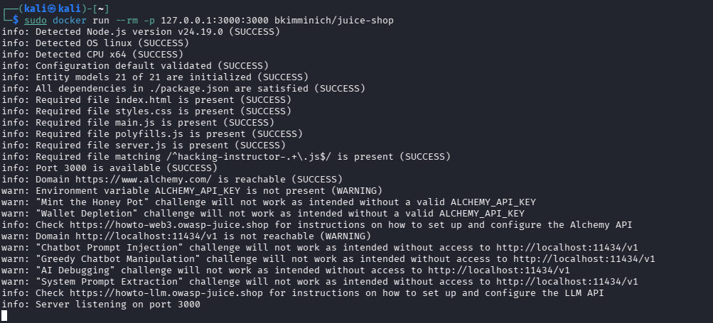
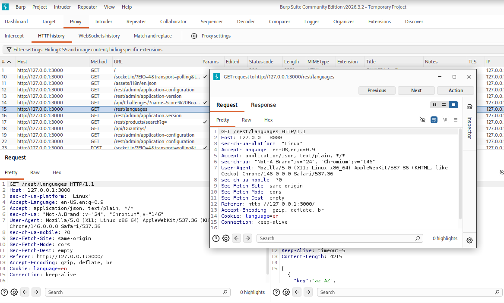
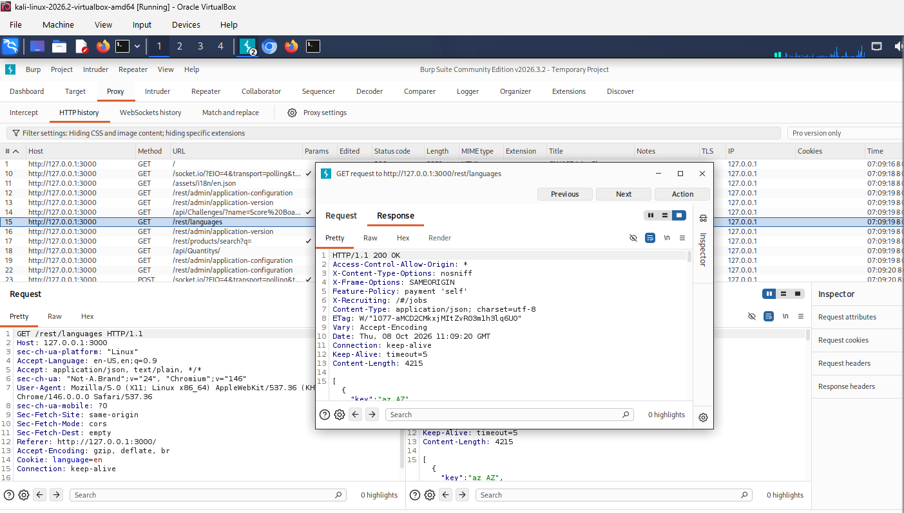
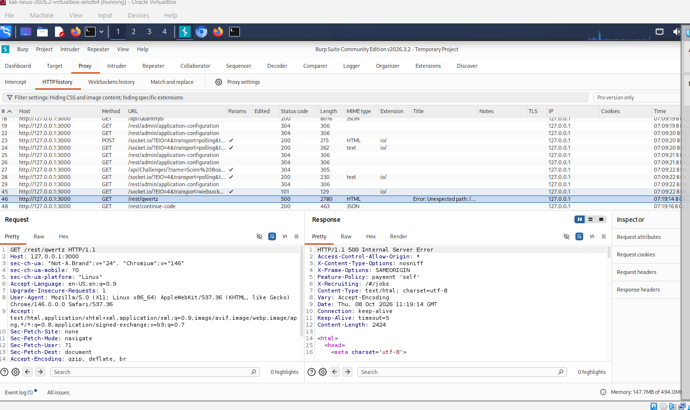
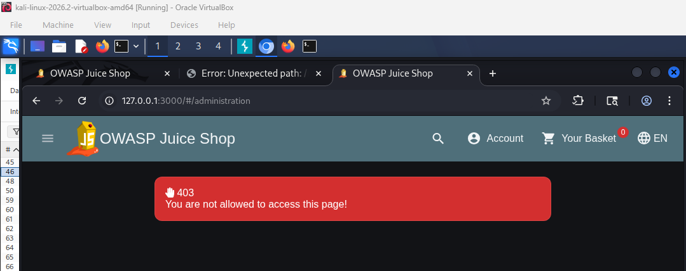
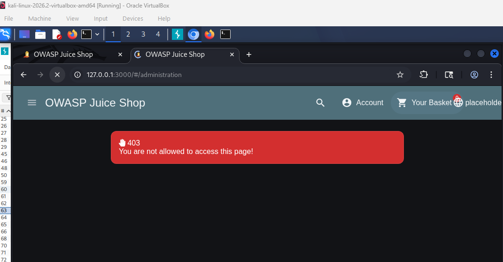
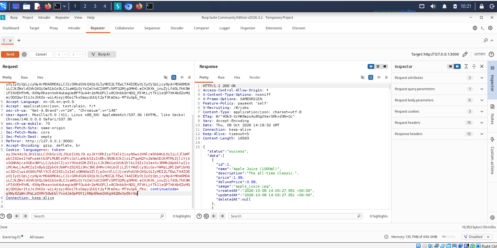
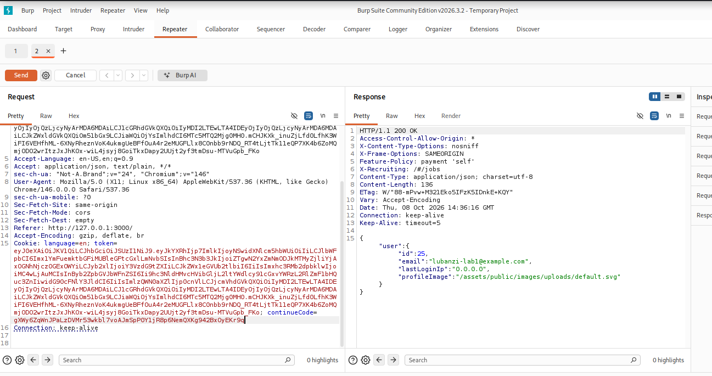

# Module 3: Web Application Security Demo Walkthrough

**Student:** Lubanzi Fihla  
**Internship:** Codomax Cybersecurity Internship  
**Module:** Module 3 - Web Application Security  
**Lab Application:** OWASP Juice Shop  
**Assessment Environment:** Controlled Local Laboratory  

---

## 1. Demo Objective

The purpose of this walkthrough is to demonstrate the practical web application security activities completed during Module 3.

The assessment followed the workflow:

```text
Identify
   ↓
Test
   ↓
Assess
   ↓
Recommend Remediation
   ↓
Document
```

All testing was performed against an intentionally vulnerable OWASP Juice Shop instance hosted locally.

---

## 2. Lab Environment

The practical environment consisted of:

```text
Windows Host
      ↓
Oracle VirtualBox
      ↓
Kali Linux
      ↓
Docker
      ↓
OWASP Juice Shop
127.0.0.1:3000
```

Burp Suite Community Edition was used to inspect HTTP communication between the browser and the Juice Shop application.

### Tools Used

- Kali Linux
- Oracle VirtualBox
- Docker
- OWASP Juice Shop
- Burp Suite Community Edition
- Chromium / Burp Browser

---

## 3. Starting OWASP Juice Shop

OWASP Juice Shop was hosted locally using Docker.

The application was made available at:

```text
http://127.0.0.1:3000
```

Binding the training application to the local loopback interface kept the intentionally vulnerable application within the controlled laboratory environment.

### Evidence



## 4. Configuring Burp Suite

Burp Suite Community Edition was started using a temporary project with the default Burp configuration.

The built-in Burp browser was used to access:

```text
http://127.0.0.1:3000
```

Burp Proxy HTTP History recorded communication between the browser and the application.

### Evidence


## 5. HTTP Request and Response Analysis

An HTTP request to the application was examined using Burp Suite.

One example was:

```http
GET /rest/languages HTTP/1.1
Host: 127.0.0.1:3000
```

The application returned:

```http
HTTP/1.1 200 OK
Content-Type: application/json
```

This demonstrated the HTTP request and response lifecycle and provided practical experience examining:

- HTTP methods
- Endpoints
- Headers
- Cookies
- Status codes
- Response content

### Evidence



## 6. Application Configuration Observation

During HTTP traffic analysis, the following application endpoint was observed:

```text
/rest/admin/application-configuration
```

The endpoint returned an HTTP `200 OK` response containing application configuration information.

The observation was documented without immediately classifying the endpoint as a vulnerability because an administrative-looking endpoint alone does not prove that access control is broken.

### Evidence


# 7. WEB-001: Improper Error Handling

## Identification

The application was tested to determine how unexpected requests were handled.

## Test

The following unexpected application route was requested: /rest/qwertz

## Result

The application returned: HTTP/1.1 500 Internal Server Error with detailed error content.

## Assessment

The behavior demonstrated improper error handling because unnecessary technical information was exposed to the client.

## OWASP Classification

```text
A02:2025 Security Misconfiguration
```

## Recommended Remediation

- Implement centralized exception handling.
- Return generic client-facing error messages.
- Record detailed diagnostic information in protected server-side logs.
- Disable unnecessary debugging information in production environments.

### Evidence



# 8. WEB-002: Horizontal Broken Access Control

## Baseline

An unauthenticated user attempted to access the administration page.

The application returned:

```text
403
You are not allowed to access this page!
```

A normal authenticated user was also denied access to the administration page.

### Evidence



## Basket Authorization Test

The authenticated test account was associated with:

```text
User ID: 25
Basket ID: 6
```

The legitimate request:

```http
GET /rest/basket/6
```

returned:

```text
HTTP 200 OK
```

Using the same authenticated session, only the requested basket identifier was changed:

```http
GET /rest/basket/5
```

The application again returned:

```text
HTTP 200 OK
```

The returned resource was identified as:

```text
Basket ID: 5
User ID: 16
```

## Assessment

The authenticated user was able to retrieve a basket belonging to another user.

This demonstrated horizontal Broken Access Control because authentication was successful but object-level authorization was not adequately enforced.

## OWASP Classification

```text
A01:2025 Broken Access Control
```

## Recommended Remediation

The application should verify resource ownership server-side for every protected resource request.

If the authenticated user does not own the requested resource and does not hold an authorized role, access should be denied.

### Evidence


# 9. WEB-003: Unexpected Input Handling

## Baseline

The product-search functionality was tested using:

```text
apple
```

The application returned expected Apple-related products.

### Evidence

```text
11-search-baseline.png
```

## Unexpected Input Test

The search functionality was then tested using a single apostrophe:

```text
'
```

The application returned an HTTP `200 OK` response with behavior different from the normal search baseline.

## Assessment

The behavior indicated that unexpected user-controlled input deserved additional security review.

The test did not provide sufficient evidence to conclusively demonstrate SQL Injection.

The behavior was therefore recorded as an observation rather than overstated as a confirmed vulnerability.

## OWASP Relevance

```text
A05:2025 Injection
```

## Recommended Remediation

- Validate input server-side.
- Use parameterized queries or prepared statements.
- Treat user-controlled input strictly as data.
- Avoid direct query concatenation.
- Handle unexpected input safely.
- Apply least privilege to database accounts.

### Evidence


# 10. WEB-004: Authentication and Session Logout Analysis

## Authenticated Baseline

Before logout, the application identified the authenticated account as:

```text
User ID: 25
Email: lubanzi-lab1@example.com
```

The endpoint:

```text
/rest/user/whoami
```

returned:

```text
HTTP 200 OK
```

### Evidence


## Logout Test

The application's normal Logout function was used.

After logout:

- The authenticated email address was no longer displayed.
- The Account menu displayed `Login`.
- The shopping basket displayed `anonymous`.

## Assessment

The normal browser-side logout behavior operated as expected during this limited test.

No authentication or session logout weakness was identified.

## Related OWASP Category

```text
A07:2025 Authentication Failures
```

## Result

```text
PASS
```

### Evidence


# 11. Assessment Results

```text
WEB-001
Improper Error Handling
Confirmed Finding

WEB-002
Horizontal Broken Access Control
Confirmed Finding

WEB-003
Unexpected Input Handling
Observation - Further Validation Required

WEB-004
Authentication and Session Logout
PASS
```

---

# 12. Key Demonstration Points

The practical assessment demonstrated that:

1. HTTP requests and responses can be inspected using a web proxy.
2. Successful authentication does not automatically mean authorization is correctly enforced.
3. Object ownership must be verified server-side.
4. Applications should handle unexpected errors securely.
5. Unexpected user input should be validated and safely processed.
6. Security findings should be supported by evidence.
7. Observations should not be overstated as confirmed vulnerabilities.
8. Remediation recommendations should address the root security control.

---

# 13. Ethical Scope

All testing demonstrated in this walkthrough was performed against an intentionally vulnerable OWASP Juice Shop instance hosted locally at:

```text
127.0.0.1:3000
```

No unauthorized third-party systems, applications, websites, or networks were tested.

---

# 14. Conclusion

The Module 3 demo walkthrough demonstrated the complete security-assessment workflow:

```text
Understand the Application
        ↓
Observe HTTP Communication
        ↓
Identify Security Behavior
        ↓
Perform Controlled Testing
        ↓
Evaluate Evidence
        ↓
Map to OWASP
        ↓
Recommend Remediation
        ↓
Document Findings
```

The practical lab strengthened my understanding of web application security, HTTP analysis, access control, input handling, authentication, session management, evidence-based vulnerability reporting, and secure remediation.