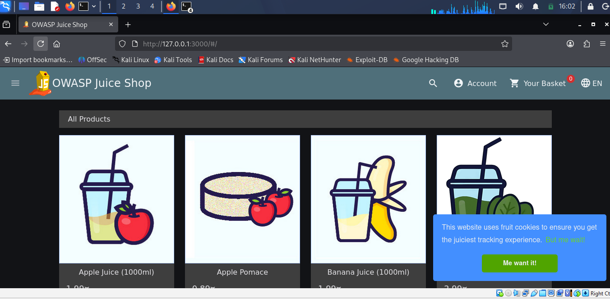
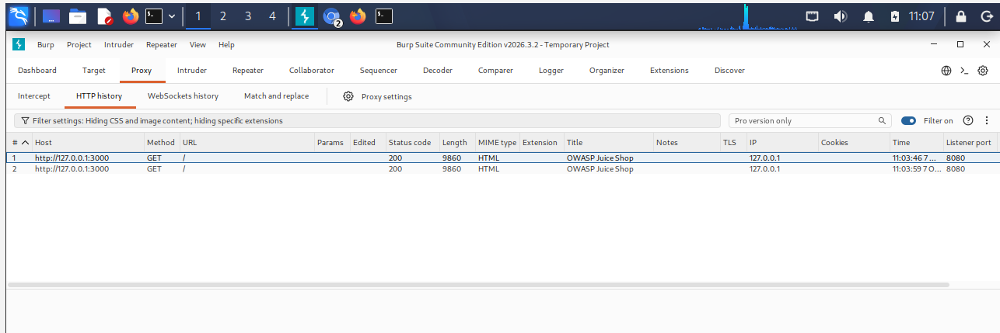
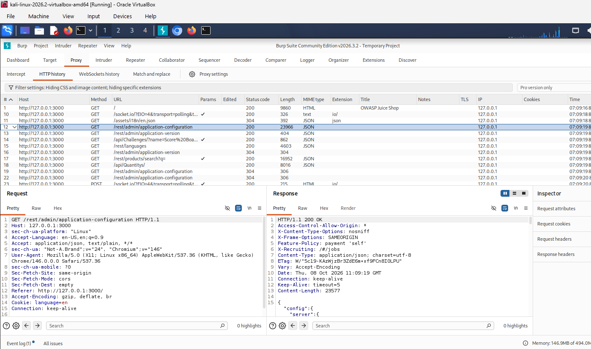
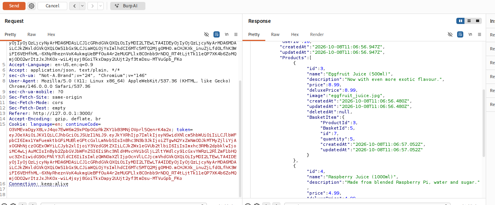
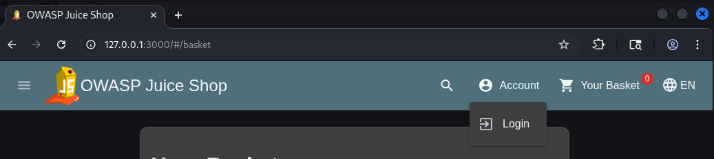

Module 3: Web Application Security
Internship: Codomax Cybersecurity Internship
Module: Module 3
Week: Week 3 - Day 11 to Day 15
Student: Lubanzi Fihla
Level: Intermediate

Overview
Module 3 focused on web application security fundamentals, the OWASP Top 10:2025, secure coding practices, and practical vulnerability analysis in a controlled laboratory environment.

The practical assessment was performed against OWASP Juice Shop hosted locally in a Kali Linux virtual machine using Docker.

Burp Suite Community Edition was used to observe and analyze HTTP requests and responses during the laboratory exercises.

Objectives
The objectives of this module were to:

Understand how web applications communicate using HTTP requests and responses.
Understand cookies, sessions, authentication, and authorization.
Study the OWASP Top 10:2025.
Learn secure coding and remediation practices.
Perform controlled web application security testing.
Identify and document security findings.
Develop remediation recommendations.
Produce a vulnerability report and demo walkthrough.
Lab Environment
The practical lab used:

Kali Linux
Oracle VirtualBox
Docker
OWASP Juice Shop
Burp Suite Community Edition
Chromium / Burp Browser
The OWASP Juice Shop application was hosted locally at:

http://127.0.0.1:3000
All security testing was restricted to this intentionally vulnerable local training environment.

Assessment Methodology
The practical assessment followed the workflow:

Identify>>Test>>Assess>>Recommend Remediation>>Document

Findings Summary
WEB-001: Improper Error Handling
OWASP Category: A02:2025 Security Misconfiguration
Result: Confirmed Finding

An unexpected application route returned an HTTP 500 Internal Server Error with detailed error content.

WEB-002: Horizontal Broken Access Control
OWASP Category: A01:2025 Broken Access Control
Result: Confirmed Finding

The authenticated test user was associated with basket ID 6 and user ID 25.

Using the same authenticated session, basket ID 5, belonging to user ID 16, was successfully retrieved with an HTTP 200 OK response.

This demonstrated insufficient object-level authorization.

WEB-003: Unexpected Input Handling
OWASP Relevance: A05:2025 Injection
Result: Observation

Normal product search input was compared with unexpected apostrophe input.

Different application behavior was observed. The evidence was documented as an input-handling observation rather than conclusively classified as SQL Injection.

WEB-004: Authentication and Session Logout
Related OWASP Category: A07:2025 Authentication Failures
Result: PASS

The application's normal logout workflow removed the authenticated browser state.

After logout, the account returned to anonymous operation and protected account functionality required authentication again.

Security Testing Results
WEB-001  Confirmed Finding
WEB-002  Confirmed Finding
WEB-003  Observation
WEB-004  PASS
Project Documentation
This repository contains the following supporting documents:

OWASP-Analysis.md
Vulnerability-Report.md
Remediation-Recommendations.md
Demo-Walkthrough.md
Practical Evidence
Practical screenshots from the controlled laboratory are stored in the Screenshots/

Evidence includes:
### Controlled Lab Environment

### HTTP Traffic Analysis

### WEB-001 - Improper Error Handling

### WEB-002 - Horizontal Broken Access Control

### WEB-004 - Session After Logout

OWASP Juice Shop laboratory setup
HTTP request and response analysis
Error-handling testing
Access-control testing
Input-handling analysis
Authentication and session testing
Ethical Scope
All security testing documented in this repository was performed against an intentionally vulnerable OWASP Juice Shop instance running locally in a controlled laboratory environment.

No unauthorized third-party applications, systems, websites, or networks were tested.

Key Lessons Learned
Module 3 strengthened my understanding of how web applications, networking, and cybersecurity work together.

The most important lessons included:

Authentication and authorization are separate security controls.
Authorization must be enforced server-side.
User-controlled object identifiers should never replace proper ownership checks.
Unexpected input should be handled safely.
Database operations should use parameterized queries.
Applications should fail securely without exposing unnecessary diagnostic information.
Security findings should be based on evidence rather than assumptions.
Remediation guidance is as important as identifying the original vulnerability.
Conclusion
Module 3 provided practical experience analyzing web application security in a safe laboratory environment.

The combination of OWASP Top 10 theory, secure coding principles, Burp Suite traffic analysis, controlled vulnerability testing, and remediation planning strengthened my understanding of professional web application security assessment.

The project also reinforced the importance of clearly defining testing scope, documenting evidence, avoiding unsupported conclusions, and providing actionable remediation recommendations.
