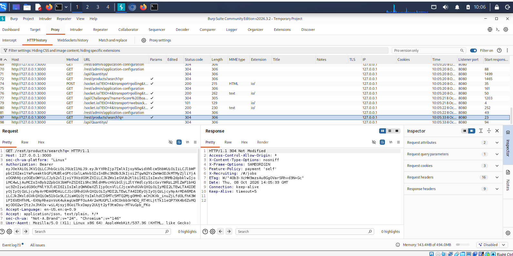

# Web Application Vulnerability Report

**Student:** Lubanzi Fihla  
**Internship:** Codomax Cybersecurity Internship  
**Module:** Module 3 - Web Application Security  
**Assessment Type:** Controlled Web Application Security Assessment  
**Target:** OWASP Juice Shop  
**Target Address:** `127.0.0.1:3000`

---

## 1. Executive Summary

A controlled web application security assessment was performed against a locally hosted OWASP Juice Shop training application.

The purpose of the assessment was to apply web application security concepts learned during Module 3, including HTTP traffic analysis, authentication, authorization, input handling, error handling, OWASP Top 10 classification, and remediation planning.

The assessment identified:

```text
2 Confirmed Security Findings
1 Security Observation
1 Passed Security Control Test
```

The most significant confirmed finding involved horizontal Broken Access Control, where an authenticated test user was able to retrieve a shopping basket belonging to another user.

Improper error handling was also identified when the application returned detailed error information after receiving an unexpected request.

Unexpected product-search behavior was recorded as an input-handling observation. The evidence gathered was not sufficient to conclusively classify the behavior as SQL Injection.

The tested logout workflow correctly removed the authenticated browser state.

---

## 2. Assessment Scope

Testing was limited to the intentionally vulnerable OWASP Juice Shop application running locally at:

```text
http://127.0.0.1:3000
```

### Environment

```text
Operating System: Kali Linux
Virtualization: Oracle VirtualBox
Container Platform: Docker
Application: OWASP Juice Shop
Web Proxy: Burp Suite Community Edition
Browser: Chromium / Burp Browser
```

No unauthorized third-party applications, websites, networks, or systems were tested.

---

## 3. Assessment Methodology

The assessment followed the workflow:

```text
Identify
   ↓
Test
   ↓
Assess
   ↓
Recommend Remediation
   ↓
Document
```

HTTP requests and responses were observed using Burp Suite Community Edition.

Security testing focused on:

- Error handling
- Access control
- Authentication
- Authorization
- Session behavior
- Input handling
- HTTP status codes
- Application endpoints
- OWASP Top 10 classification

---

# 4. WEB-001: Improper Error Handling

**OWASP Category:** A02:2025 Security Misconfiguration  
**Status:** Confirmed Finding

## Description

An unexpected application route was requested:

```http
GET /rest/qwertz
```

The application returned:

```http
HTTP/1.1 500 Internal Server Error
```

along with detailed error information.

## Security Impact

Verbose application errors may reveal implementation or diagnostic information that should not be exposed to application users.

This information may provide additional insight into the internal operation of the application and assist further security analysis.

## Evidence


## Remediation

- Implement centralized exception handling.
- Return generic client-facing error messages.
- Store detailed diagnostic information in protected server-side logs.
- Avoid exposing stack traces, internal paths, framework details, or database information.
- Monitor repeated application errors for suspicious activity.

---

# 5. WEB-002: Horizontal Broken Access Control

**OWASP Category:** A01:2025 Broken Access Control  
**Status:** Confirmed Finding

## Description

The authenticated test user was associated with:

```text
User ID: 25
Basket ID: 6
```

The legitimate request:

```http
GET /rest/basket/6
```

returned:

```text
HTTP 200 OK
```

Using the same authenticated session, only the basket identifier was changed:

```http
GET /rest/basket/5
```

The application again returned:

```text
HTTP 200 OK
```

The response identified the requested resource as:

```text
Basket ID: 5
User ID: 16
```

The authenticated user therefore retrieved a basket belonging to a different user.

## Security Impact

Insufficient object-level authorization may allow authenticated users to access resources belonging to other users.

In a real application, this type of weakness could expose:

- Customer information
- Shopping information
- Order details
- Account-related information
- Other user-specific resources

## Evidence


## Remediation

The server should verify authorization for every request involving protected resources.

The authorization workflow should resemble:

```text
Authenticated User
       ↓
Requested Resource
       ↓
Determine Resource Owner
       ↓
Is User Authorized?
      / \
    YES  NO
     ↓    ↓
  ALLOW  DENY
```

Recommended controls:

- Verify resource ownership server-side.
- Deny access by default.
- Apply least privilege.
- Enforce authorization on every protected request.
- Do not trust user-controlled object identifiers as proof of authorization.
- Return an appropriate access-denied response when authorization fails.

---

# 6. WEB-003: Unexpected Input Handling

**OWASP Relevance:** A05:2025 Injection  
**Status:** Observation - Further Validation Required

## Description

The product-search functionality was initially tested using:

```text
apple
```

The application returned expected Apple-related products.

The search functionality was then tested using a single apostrophe:

```text
'
```

The application returned an HTTP `200 OK` response with behavior different from the normal search baseline.

## Security Impact

Unexpected behavior in response to metacharacters may indicate insufficient input validation or unsafe downstream processing.

Where untrusted input is incorporated into database queries without appropriate protection, Injection vulnerabilities may become possible.

The available evidence did not conclusively demonstrate SQL Injection, and the finding was therefore recorded as an observation rather than a confirmed SQL Injection vulnerability.

## Evidence



## Remediation

- Validate user input according to expected format and business requirements.
- Use parameterized queries or prepared statements for database operations.
- Treat user input strictly as data.
- Avoid direct concatenation of untrusted input into queries.
- Apply least privilege to database accounts.
- Handle invalid input safely.

---

# 7. WEB-004: Authentication and Session Logout Analysis

**Related OWASP Category:** A07:2025 Authentication Failures  
**Status:** PASS

## Description

Before logout, the `/rest/user/whoami` endpoint returned:

```text
HTTP 200 OK

User ID: 25
Email: lubanzi-lab1@example.com
```

The application's normal Logout function was then used.

After logout:

- The authenticated email address was no longer displayed.
- The Account menu displayed `Login`.
- The shopping basket displayed `anonymous`.

## Assessment Result

The authenticated browser state was removed correctly during the tested logout workflow.

No authentication or session logout weakness was identified during this limited test.

## Evidence


## Security Recommendation

Applications should continue to:

- Protect authentication and session tokens.
- Use securely generated session identifiers.
- Expire authenticated sessions appropriately.
- Remove authenticated client state after logout.
- Invalidate server-side sessions or tokens where applicable.
- Require authentication again before allowing access to protected functionality.

---

# 8. Findings Summary

```text
WEB-001
Improper Error Handling
A02:2025 Security Misconfiguration
Confirmed Finding

WEB-002
Horizontal Broken Access Control
A01:2025 Broken Access Control
Confirmed Finding

WEB-003
Unexpected Input Handling
A05:2025 Injection Relevance
Observation - Further Validation Required

WEB-004
Authentication and Session Logout Analysis
A07:2025 Authentication Failures
PASS
```

---

# 9. Overall Assessment

The controlled assessment demonstrated that authentication alone is not sufficient to protect user resources.

The most significant observed weakness was WEB-002, where authenticated identity was established correctly but authorization was not adequately enforced for access to another user's basket.

The assessment also demonstrated why security testing should distinguish between confirmed vulnerabilities, observations requiring additional validation, and controls that operate as expected.

---

# 10. Conclusion

The Module 3 vulnerability assessment provided practical experience identifying, validating, classifying, and documenting web application security behavior.

Two security findings were confirmed, one input-handling observation was recorded for further validation, and one authentication/session security control passed the limited test.

The assessment reinforced the importance of evidence-based vulnerability reporting and actionable remediation recommendations.